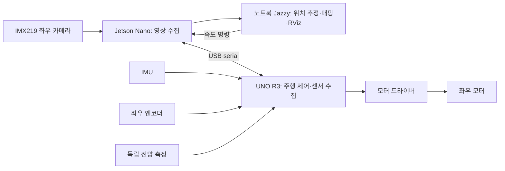

# JetBot Mini 재설계 v0.1

작성일: 2026-11-19 KST. 상태: 설계 초안. 하드웨어 교체·펌웨어 업로드·실주행은 수행하지 않았다.

## 추가 확인: 사용자가 제시한 모터 외형

후속으로 사용자가 제시한 [아이씨뱅큐 P013035379](https://www.icbanq.com/P013035379)는 **Yahboom Jetbot mini AI Vision Robot Car ROS Starter Kit for NVIDIA Jetson Nano 4GB**의 판매 페이지다. 이 링크를 재설계 대상 키트의 제품 식별 근거로 기록한다. 조회된 본문에는 개별 모터의 정격 전압·감속비·구속 전류가 없어, PP-A438 사양을 순정 모터 사양으로 확정할 수 없다. 제조사 자료는 [Yahboom jetbot-mini 저장소](https://github.com/YahboomTechnology/jetbot-mini)에서 확인하며, NVIDIA-AI-IOT의 별도 jetbot_mini 하드웨어와 구분한다.

사용자가 제공한 상품 사진에는 `PartS PP-A438`이 표시되어 있다. 판매처의 제품명은 **아두이노 DC 기어박스 모터 1:48**이며, 흔히 TT 기어드 DC 모터라고 부르는 형태다. 사용자는 실물의 정확한 이름은 아직 모른다고 했으므로 **외형 참고 후보**로 기록한다. 실제 JetBot 장착 모터가 이 상품과 동일하다고 확정하지 않는다.

[PP-A438 판매처 사양](https://parts-parts.co.kr/product/detail.html?cate_no=331&display_group=1&product_no=2083): DC 3~6 V, 감속비 1:48, 무부하 전류 150 mA ±10%, 속도 표기 3 V에서 90 ±10% RPM / 6 V에서 200 ±10% RPM. 구속 전류는 해당 사양에 제시되지 않았다.

이 제품과 동일한 모터로 확인되면 모터 전원 경로를 3~6 V 범위에 맞춘다. 기존 약 12 V 배터리를 모터에 직접 공급하지 않는다. L293D의 전압 손실을 정전압 전원 대용으로 사용하지 않는다. 무부하 150 mA만으로 L293D의 실제 주행·기동 전류 적합성을 판단할 수 없다.

사진에는 엔코더 센서나 계수 배선이 보이지 않는다. 양쪽으로 축이 나오는 형태여도 엔코더 내장을 뜻하지 않는다. 실물의 축·장착 공간을 확인해 외장 엔코더 또는 엔코더 포함 모터 교체를 검토한다. 차체 무게·바퀴·모터 브래킷 적합성 확인 전에는 이 모터로 교체하는 결정을 확정하지 않는다.

## 1. 대화 근거와 설계 결정

사용자는 이 대화에서 아두이노를 **사진 속 UNO R3 계열**로 확정했다. UNO Q 관련 배선·전원 가정은 적용하지 않는다.

- 모터 제어와 전압 측정 경로를 분리하고 독립 계측으로 실제 전압 강하를 확인한다.
- UNO의 IMU 데이터를 USB로 ROS 2에 전달하는 구성을 검토한다.
- 기존 실험에서 15 cm 손 이동을 영상 오도메트리가 약 62.3 cm로 추정했다. 엔코더 계측을 추가할 근거다.
- 두 I²C 읽기 방식에서 같은 보드의 낮은 원시값을 읽었다. 이상이 관찰된 시점의 배터리 단자 전압은 확인되지 않았다.

설계 방향은 **기존 차체·Nano·카메라를 유지하고, UNO R3로 주행과 센서를 분리하며, 노트북에서 엔코더·IMU 기반 위치 추정과 스테레오 매핑을 결합**하는 것이다.

## 2. 현재 확인한 상태

- Nano: JetPack 4.6.1 계열 / L4T R32.7.1. 기존 Humble 컨테이너와 카메라 수집 경로가 있다.
- 노트북: Ubuntu 24.04 / ROS 2 Jazzy. 영상 정렬·매핑·RViz를 담당한다.
- 카메라: IMX219 2대, 실측 렌즈 중심 간격 106~107 mm. 640×480, 15 fps 경로를 우선 유지한다.
- 기본 `calibration/right.yaml`의 P 행렬에서 계산한 간격은 108.9285 mm, `calibration/trial-106mm/right.yaml`은 106.5382 mm이다. 두 보정은 서로 다른 프로파일이다. 간격 숫자가 실측과 가깝다는 이유만으로 정확도를 확정하지 않는다.
- 카메라 높이 실측 범위는 9.8~10.0 cm. 기본 launch의 pitch는 0도지만 `start_calibration_trial.sh`의 시험 기본값은 하향 3.5도이다. 브래킷을 바꾸면 높이·pitch·roll을 다시 측정한다.
- `diagnostics/20261119-142749-trial-calibration-15cm.jsonl`에서 시작·이동 후 x 차이는 약 −0.6226 m이다. 사용자가 수행한 15 cm 이동과 맞지 않는다.
- `diagnostics/20261119-164003-motor-adc-byte-check.jsonl`은 1,140개 driver 샘플 중 저전압 샘플 10개를 기록했다. 이전 대화에서 약 51초 주기의 상위 바이트 소실을 분석했다. 독립된 물리 전압 측정은 남아 있다.
- 엔코더 계측은 현재 구현되지 않았다. 기존 모터에 엔코더가 있는지, 장착 가능한지도 미확인이다.

## 3. 전체 구성



| 구성품 | 역할 | 결정 |
|---|---|---|
| 기존 차체·바퀴 | 기구 기반 | 유지, 바퀴 지름·윤거 실측 |
| Jetson Nano | CSI 카메라 수집, USB serial 중계 | 기존 환경 유지 |
| 노트북 | ROS 2 브리지·센서 융합·매핑 | 기존 Jazzy 사용 |
| UNO R3 | IMU·엔코더·전압 읽기, 모터 제어, 통신 단절 정지 | 확정 |
| HW-130 L293D 실드 | 초기 모터 시험 | 조건부 사용 |
| IMU | 단기 각속도, 기울기 관측 | GY-521/MPU-6050을 보유 후보로 가정, 실제 모듈 확인 필요 |
| 좌우 엔코더 | 실제 바퀴 이동 관측 | 추가 우선순위 높음 |
| 최종 모터 드라이버 | 좌우 독립 구동 | 모터·배터리 사양 확인 후 선정 |

엔코더를 추가하기 전에는 IMU와 영상의 실험 플랫폼 단계로 본다. IMU만 추가해 15 cm 이동 오차가 해결됐다고 판단하지 않는다. 바퀴 엔코더도 미끄러짐을 측정하지 못하므로 실측 검증과 지도 관측이 필요하다.

## 4. 전원과 모터 드라이버

전원 분배의 목표 형태:

```text
배터리 → 퓨즈·주전원 스위치 → 분배점
  ├─ Nano용 규정 5 V 전원 → Nano·카메라
  ├─ 모터에 맞는 전원 경로 → 모터 전원 차단 스위치 → 드라이버 VM
  └─ 독립 전압 측정 회로 → UNO ADC

UNO 논리 전원: 초기에는 Nano USB 사용
공통 GND: 분배점으로 복귀, 모터 전류가 UNO·센서 배선을 통과하지 않게 배치
```

이는 전원 계통 분리이지 전기적 절연이 아니다. 공통 배터리 자체의 전압 강하는 두 계통에 영향을 줄 수 있다. 기존 Yahboom 보드가 Nano용 전원 변환도 담당하는지 확인한 뒤 대체 전원을 준비한다. 모터 제어부 분리와 보드 전체 제거는 별도 단계다.

배터리 셀 수·완충 전압·BMS, 모터 정격 전압·기동/구속 전류를 먼저 확인한다. 기존 로그의 약 12 V만으로 배터리 종류를 확정하지 않는다. Nano 전원 변환기는 카메라·USB·팬을 포함한 실제 부하와 순간 부하를 기준으로 정한다.

L293D는 채널당 600 mA급이며 전압 손실과 발열을 고려해야 한다. 1.2 A는 100 µs 이하 비반복 피크로, 모터 기동 전류를 지속적으로 허용하는 정격이 아니다. 따라서 가지고 있는 실드는 초기 시험 후보로 두고, 최종 드라이버는 VM 범위·실제 모터 전류·방열·전류 제한·오류 출력을 기준으로 선정한다. [TI 데이터시트](https://www.ti.com/lit/ds/symlink/l293d.pdf)

모터 전원과 USB 논리 전원을 분리할 때 HW-130의 전원 점퍼와 실물 회로를 먼저 확인한다. UNO의 5 V와 별도 전원 출력이 의도치 않게 연결되지 않게 한다. 모터를 UNO의 5 V 출력으로 공급하지 않는다. V1 계열 실드의 분리 전원 취지는 [Adafruit 전원 설명](https://learn.adafruit.com/adafruit-motor-shield/faq)을 참고하되 HW-130과 동일 회로라고 단정하지 않는다.

전압 측정은 ADC 입력 범위에 맞춘 분압·필터·보호 회로를 사용한다. 배터리 최대 전압이 확인되기 전에는 저항값을 확정하지 않는다. 실제 Vref로 환산하고 독립 계측값과 비교한다. 센서 단선·범위 이탈·낡은 데이터는 정상 전압으로 치환하지 않는다. 기존 9.9 V 보호는 현재 운용값으로 보존하고, 새 임계값은 셀 종류·BMS에 근거해 결정한다.

## 5. UNO R3 핀 배치 초안

**실물 HW-130이 Adafruit V1 표준 핀 배치와 같은지 확인하는 조건**의 배치다. 아래 연결은 아직 수행하지 않았다.

| UNO R3 / 실드 | 배치 | 비고 |
|---|---|---|
| 실드 M1 | 왼쪽 모터 | PWM D11 |
| 실드 M3 | 오른쪽 모터 | PWM D5 |
| D4·D7·D8·D12 | 실드 방향 제어 | 74HC595 제어, 센서용으로 공유하지 않음 |
| D2 / A0 | 왼쪽 엔코더 A / B | A 변화 인터럽트에서 B를 읽는 x2 방식 후보 |
| D3 / A1 | 오른쪽 엔코더 A / B | M2를 쓰지 않아 D3 PWM 충돌 회피 |
| A2 | 배터리 분압 입력 | 최대 전압·Vref 확인 후 회로 확정 |
| A4 / A5 | IMU SDA / SCL | 3.3 V 측 I²C와 적절한 레벨 변환 |
| D0 / D1 | USB serial | 다른 장치 연결에 사용하지 않음 |

V1 표준 핀 사용 근거는 [실드 FAQ](https://learn.adafruit.com/adafruit-motor-shield/faq)에 있다. M1·M3를 선택하면 엔코더용 D2·D3를 남길 수 있다는 것은 이 핀맵에서 도출한 설계 판단이다. 엔코더의 출력 전압·오픈 컬렉터 여부·최고 펄스율을 확인하고 풀업과 ISR 부하를 계산한다. x2 계수 기준을 펌웨어와 ROS 변환에서 일치시킨다.

UNO R3의 5 V I²C와 MPU-6050 센서 측 전압을 구분한다. GY-521은 제조사별 레귤레이터·풀업 구성이 달라 VCC 표기만으로 SDA/SCL 허용 전압을 판단하지 않는다. 초기 IMU 시험은 모터 실드를 빼고, 확인된 센서 전원 및 양방향 I²C 레벨 변환기로 구성한다. MPU-6050 자체는 3축 가속도·3축 자이로 센서이며 절대 방위각을 측정하는 자력계가 없다. [MPU-6050 사양](https://product.tdk.com/system/files/dam/doc/product/sensor/mortion-inertial/imu/data_sheet/mpu-6000-datasheet1.pdf)

IMU는 차체의 단단한 부위에 고정하고 모터·전원선에서 거리를 둔다. 소프트웨어에서 센서 축을 x 전방·y 좌측·z 위쪽인 본체 축으로 변환한다. 카메라는 수평·평행 장착과 브래킷 강성을 우선하고, 장착을 바꾸면 공동 보정을 다시 한다.

## 6. 펌웨어·USB·ROS 2 계약

UNO는 센서 수집·엔코더 계수·모터 PWM 및 엔코더 기반 속도 제어를 맡는다. ROS 2 메시지 생성과 센서 융합은 Nano/노트북에서 처리한다. UNO에 ROS 2 런타임을 직접 올리는 구성을 기본으로 삼지 않는다.

초기 목표 주기: IMU 100 Hz, 엔코더·속도 보고 50 Hz, 모터 제어 50~100 Hz, 전압 보고 5~10 Hz. 실제 I²C·serial·인터럽트 부하를 측정한 뒤 조정한다. serial은 115200 baud 후보이며, 프레임 크기를 제한한 binary 패킷으로 설계한다. 예를 들어 64 byte × 100 Hz는 6.4 kB/s이고, 8N1의 이론 상한 약 11.5 kB/s 안에서 다른 패킷·재전송 여유까지 계산한다.

패킷에는 버전·길이·sequence·MCU 측 취득 시각·데이터·CRC를 둔다. MCU 시각의 wrap과 재부팅 epoch를 처리하고 호스트 시계로 정렬한다. ROS 타임스탬프를 단순 수신 시각으로만 채우지 않는다. serial 재연결 시 오래된 주행 명령을 재생하지 않는다.

| ROS 인터페이스 초안 | 내용 |
|---|---|
| `/cmd_vel` | 노트북 제어 명령, Nano bridge로 전달 |
| `/imu/data_raw` | `sensor_msgs/Imu`, rad/s·m/s², `imu_link` |
| `/wheel/odom` | `nav_msgs/Odometry`, 엔코더 관측, TF 발행 안 함 |
| `/joint_states` | 좌우 바퀴 관절 상태 |
| `/battery_state` | `sensor_msgs/BatteryState`, 미계측 전류·잔량은 미확인으로 표현 |
| `/jetbot/status` | fault·armed·마지막 명령 나이·센서 유효성 |
| `/odometry/filtered` | 융합된 본체 기준 오도메트리 |
| `/jetbot/stop` | 명시 정지·비활성화 요청 |

orientation을 계산하지 않은 IMU 메시지는 `orientation_covariance[0] = -1`로 표시한다. 자이로·가속도 공분산은 정지 기록과 단위 변환에 근거해 정한다. [ROS Imu 메시지 정의](https://github.com/ros2/common_interfaces/blob/jazzy/sensor_msgs/msg/Imu.msg)

시작·리셋·USB 재연결 후 기본 상태는 DISARMED이다. 정상 센서 상태에서 명시적으로 arm하고 새 명령을 받은 뒤만 구동한다. UNO 자체가 마지막 유효 명령 이후 300 ms 이내 PWM을 0으로 만들고 구동을 비활성화한다. CRC 오류 프레임은 watchdog을 갱신하지 않는다. 저전압·센서 오류·MCU watchdog·연결 단절 때 오류를 기록하고, 재연결만으로 자동 재출발하지 않는다. 모터 전원을 끊는 물리 스위치를 별도로 둔다.

## 7. 위치 추정과 매핑

로컬 위치 추정의 1차 입력은 엔코더 선속도와 IMU yaw 각속도다. 평면 주행용 `robot_localization` EKF를 후보로 사용하며 IMU 가속도의 이중 적분으로 이동 거리를 만들지 않는다. 같은 엔코더에서 나온 pose·twist를 독립 관측처럼 중복 반영하지 않는다. 영상 추정은 실측 이동·회전 시험과 이상치 검사를 통과한 뒤 속도 입력 등으로 단계적으로 추가한다. 패키지별 실제 파라미터는 설치된 Jazzy 버전에서 확인한다. [공식 센서 융합 구성 문서](https://github.com/cra-ros-pkg/robot_localization/blob/rolling-devel/doc/configuring_robot_localization.rst)

목표 TF:

```text
map → odom → base_footprint → base_link → stereo_camera_link → stereo_left_optical_frame
                                     └→ imu_link
```

- `odom → base_footprint`: 로컬 EKF 한 곳에서 발행.
- `base_footprint → base_link`, 본체→카메라·IMU: 실측 장착 변환.
- `map → odom`: 매핑 모드에서는 RTAB-Map, 기존 지도 위치 추정 모드에서는 AMCL. 두 모드를 동시에 켜지 않는다.
- 현재 `partition_odom → stereo_camera_link`를 발행하는 경계 검증 경로는 새 EKF와 동시 TF 발행하지 않도록 전환한다. 기존 launch를 그대로 켜서 새 구조와 섞지 않는다.

카메라 원점의 운동은 본체 원점의 운동과 다르다. 특히 제자리 회전 시 카메라 오프셋 때문에 생기는 이동을 장착 TF로 변환한다. 본체 원점은 바퀴 축 중앙을 기준으로 정하고 위치·방향을 실측한다.

운용 모드를 분리한다:

1. **일반 스테레오 지도 생성:** RTAB-Map에 정렬 영상·CameraInfo·융합 오도메트리를 공급한다. 특징이 있는 일반 환경에서 검증한다.
2. **가림판 지도/위치 추정:** 기존 경계 검출을 별도 실험 모드로 유지한다. 저장 지도에는 벽 정보만 남기는 기존 요구를 유지하며, 미관측 영역을 자유 공간으로 채우지 않는다. 일반 지도 DB의 배경 저장과 혼동하지 않는다.

IMU 추가가 좌우 카메라 동시 노출을 만들어 주지는 않는다. 현재 PTS 기반 시각과 약 20 ms 근사 동기화는 하드웨어 동기화가 아니다. 빠른 회전에서 오차가 남으면 시각·노출·동기화를 별도로 개선한다.

## 8. 구현 순서와 통과 기준

아래 수치는 초기 설계 목표이며 달성된 성능이 아니다.

| 단계 | 구현 범위 | 다음 단계 진입 기준 |
|---|---|---|
| 1 | UNO USB + IMU 단독 | 10분 기록, 재부팅·비정상 값 없음, 목표 주기 대비 손실 1% 미만, 정지 bias와 축 방향 확인 |
| 2 | 독립 전압 측정·전원 경로 | 독립 계측 대비 오차 0.1 V 이내 목표, 10분 이상 주기적 이상값 조사, 임계값과 단선 상태 검증 |
| 3 | 좌우 엔코더 | 손으로 한 바퀴씩 정·역회전, 계수·방향 반복 일치, 최고 예상 속도에서 누락 검증 |
| 4 | 바퀴를 띄운 모터 제어 | 좌우·전후 부호 확인, 통신 단절 시 300 ms 내 출력 비활성화, 재연결 자동 출발 없음 |
| 5 | 바닥 저속 주행·속도 제어 | 실측 15 cm·1 m 직진/후진, 90도 회전 각각 5회 기록. 1 m 이동 오차 5 cm 이내·90도 오차 5도 이내 목표 |
| 6 | EKF·기준 좌표계 통합 | 같은 시험에서 엔코더·IMU·융합·영상 결과 비교, TF 단일 발행, 추적 손실·센서 지연 처리 확인 |
| 7 | 매핑·기존 지도 위치 추정 | 닫힌 경로 재방문·정지·재출발 비교, 지도 왜곡·누적 오차 기록 후 Nav2 도입 여부 결정 |

시험 기록에는 적용 보정 경로·파일 해시·카메라 장착 치수·실측 거리·IMU bias·엔코더 계수·전압·타임스탬프·fault를 함께 남긴다. 기존 자동 테스트는 해당 소프트웨어 검증이며, 새 배선이나 주행 정확도의 검증을 대신하지 않는다.

## 9. 제작 전 남은 치수·사양

- 배터리 셀 종류·셀 수·완충 전압·방전 허용 전류와 BMS.
- 모터 정격 전압·구속 전류·기어비, 엔코더 유무·출력 전압·계수 기준.
- HW-130 실드 핀맵·전원 점퍼·실제 장착 부품.
- 바퀴 실효 지름·좌우 바퀴 접지 중심 사이 거리, 카메라·IMU 장착 변환.
- 기존 보드의 Nano 전원 공급 역할과 대체 5 V 전원 용량.

**바로 진행할 첫 제작 범위는 UNO R3 + IMU + USB 데이터 수집이다.** 모터·배터리 사양을 확보하면서 엔코더 장착 방법을 정하고, 그 결과로 최종 드라이버와 전원 부품을 확정한다. 이 문서는 배선 완료나 실주행 성공을 의미하지 않는다.
