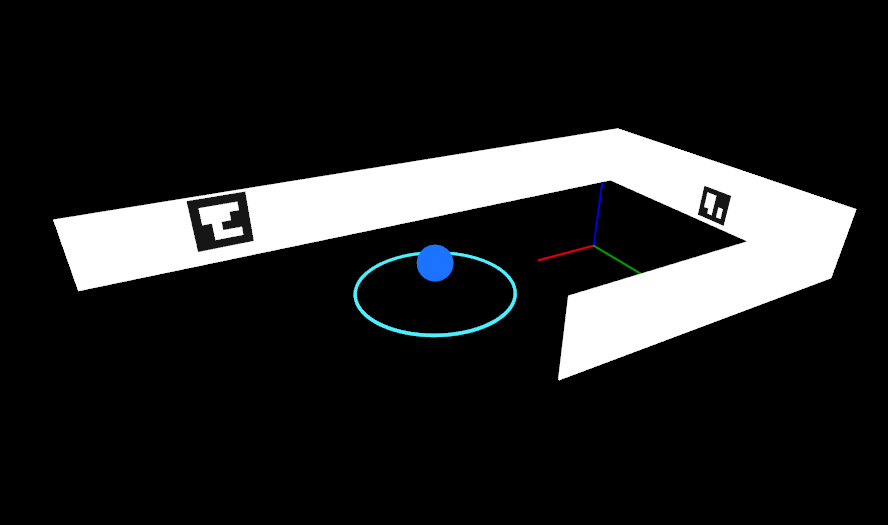

# JetBot Mini 스테레오 매핑 실험 기록

2026년 11월 25일까지 확인한 결과입니다. 흰 가림판 세 면을 RTAB-Map에서 볼 수 있게 만들었습니다. ID 22와 ID 23은 한 판의 앞뒤에 있고, ID 24는 ID 22를 바라볼 때 왼쪽 벽에 있습니다. 오른쪽 벽은 회전 촬영으로 확인하고 실측 길이 90 cm를 반영했습니다. ID 25를 새 방식으로 매핑하는 작업은 11월 26일에 이어서 진행합니다.

RTAB-Map Database Viewer에서 [지도 DB](rtabmap-white-wall-snapshot.db)를 열고 **File → View optimized mesh**를 선택하세요. 흰 면은 가림판, 파란 구는 마지막으로 ID 22가 관측된 구간의 왼쪽 카메라 위치, 하늘색 원은 임시 오차 표시입니다. 반대편 마커는 메시를 돌려 보면 확인할 수 있습니다. 로봇이나 ROS 2를 실행하지 않아도 이 파일을 볼 수 있습니다.

[벽·마커·위치 수치 JSON](wall-and-position-results.json) · [오른쪽 모서리와 끝점의 스테레오 검출 JSON](right-corner-stereo.json)

## 1. 설치와 촬영 조건

| 항목 | 확인한 값 |
|---|---|
| 장치 | Jetson Nano Developer Kit, L4T R32.7.1, Ubuntu 18.04 호스트, JetPack 4.6.1 계열 |
| ROS 2 | Nano의 Humble Docker 컨테이너에서 카메라와 모터 연결, 노트북의 Jazzy에서 영상 처리·RTAB-Map·RViz |
| 카메라 | CSI IMX219 두 대, 640×480, 카메라당 보통 15 fps |
| 렌즈 중심 간격 | 초기 57 mm, 변경 후 실측 106~107 mm, 오늘 경계 검출에 쓴 보정의 기준선 약 106.48 mm |
| 왼쪽 렌즈 높이 | 실측 9.8~10.0 cm, 계산에 9.9 cm 사용 |
| 체커보드 | 9×7칸, OpenCV 내부 교차점 8×6. 보조 모니터는 25 mm/칸, iPhone은 실측 가로 90 mm/9칸으로 10 mm/칸 |
| 지도 좌표계 | 실험 공간을 변환한 기존 2D 점유 지도의 `map`, 격자 간격 2.5 cm |

Nano에서 Argus/GStreamer로 두 CSI 영상을 받았습니다. 파일에는 영상과 프레임별 시각을 저장했고, 가까운 좌우 시각끼리 짝지었습니다. 시간 차가 큰 쌍, 패턴이 잘린 프레임, 비슷한 자세의 중복 프레임을 선별했습니다. 좌우 카메라의 하드웨어 동기화 여부는 확인하지 않았습니다. 정지한 장면의 벽 판정에 최대 35 ms의 짝짓기 차이를 허용했습니다.

## 2. 사용한 알고리즘과 역할

| 처리 | 방법과 결과 |
|---|---|
| 스테레오 보정 | 체커보드 코너 검출과 OpenCV 카메라 보정으로 내부행렬, 렌즈 왜곡, 좌우 상대 자세를 계산했습니다. `stereoRectify`와 `remap`으로 영상을 정렬했습니다. |
| 거리 계산 | 정렬된 영상의 수평 시차를 사용해 `깊이 = 초점거리(px) × 기준선(m) ÷ 시차(px)`로 광축 방향 깊이를 구했습니다. 카메라에서 점까지의 직선거리, 벽에 수직으로 잰 거리는 각각 구분했습니다. |
| 밀집 시차와 벽 평면 | StereoBM, StereoSGBM의 기본·3WAY·HH4, WLS, RANSAC 평면을 비교했습니다. 흰 판 중앙에는 질감이 적어 시차가 많이 비거나 바닥과 배경의 시차가 섞였습니다. 벽 가림이 적은 경우에는 위·아래 경계와 실측 높이로 벽까지 거리를 계산했습니다. |
| 흰 판 경계 | OpenCV의 필터링과 CLAHE, Canny/LSD 선 후보 및 색·명암·판 높이 조건을 사용했습니다. 오늘 모서리 캡처에서는 두 카메라의 경계점을 각각 강건한 직선으로 맞추고, 눈에 보이는 세로 이음새에서 두 벽의 선을 연결했습니다. |
| 점 → 선 → 벽 | 반복 관측한 점을 모아 OpenCV `approxPolyDP`의 Douglas–Peucker로 단순화했습니다. 초기 시험 허용 편차는 2 cm였습니다. 모서리의 90°와 지도 정렬은 기존 2D 지도에서 가져왔습니다. 선에 판 높이와 두께를 적용해 닫힌 삼각형 메시로 만들었습니다. |
| ArUco 위치 | 마커의 네 모서리, 크기, 지도상의 중심과 방향으로 `solvePnP`의 IPPE 정사각형 모델을 풀었습니다. 양쪽 영상 정합 및 재투영 오차를 검사한 경우에 위치를 갱신하도록 구성했습니다. 관측이 끊긴 동안 위치 갱신도 멈춥니다. 별도로 기록한 왼쪽 영상 단독 후보는 참고값입니다. |
| ORB-SLAM2 | 저장한 영상에서 스테레오 특징점 추적, 로컬 매핑, 루프 닫기를 노트북에서 시험했습니다. 추적된 프레임의 벽 선을 모았고, ORB-SLAM2 로컬 좌표는 최종 `map`과 별개로 평가했습니다. |
| RTAB-Map | 일반 스테레오 점군도 확인한 뒤, 흰 판의 빈 부분이 점군에 그대로 나타나므로 별도의 벽 메시를 저장했습니다. 최신 DB에는 벽·마커·위치 표시의 메시가 들어 있습니다. |
| CUDA와 주행 | Nano에서 CUDA 10.2로 영상 정렬을 실행했고, TensorRT 8.2.1 설치도 확인했습니다. 주행 재현은 모터 명령·상태·스테레오 영상 기록과 마커 관측을 사용했습니다. 현재 벽 복원은 노트북 CPU에서 처리했고, 위치 보정 모형 학습 및 TensorRT 추론은 미실행 상태입니다. |

[ORB-SLAM2 재생·빌드](../../../experiments/orb_slam2/README.md) · [흰 판 처리 코드](../../../experiments/orb_slam2/live_white_walls.py) · [벽 복원 코드](../../../scripts/reconstruct_white_partitions.py) · [CUDA 실험 및 학습용 수집](../../aruco-cuda-workflow.md) · [경로 재현](../../guarded-stereo-replay.md)

## 3. 거리와 보정 검증

- 120초 체커보드 녹화에서 좌우 각 1,800프레임을 기록했습니다. 보정 후보용으로 52쌍을 선별하고, 세로 잔차가 큰 8쌍을 제외한 결과도 비교했습니다.
- 독립 ID 23 여섯 자세에는 줄자로 잰 87, 64.3, 61, 116, 113.5, 191 cm 기록을 사용했습니다. `pruned-joint`의 자세별 정렬 세로 오차 중앙값은 1.17~3.34 px, 거리 최대 절대 오차는 2.83 cm였습니다. 거리에서 가장 작은 최대 오차는 `pruned-fixed`의 1.33 cm였습니다. 모든 후보가 독립 자세의 세로 1 px 기준을 통과하지 못했습니다.
- ID 23이 붙은 벽의 **수직거리**는 실측 79.7 cm에서 경계 방식 83.11 cm, 실측 120.1 cm에서 125.30 cm였습니다. 첫 시험에서 구한 거리 배율 0.9590을 두 번째 시험에 적용하면 120.16 cm였습니다. 두 거리에서의 비교 결과이며 다른 벽이나 시야각에서의 성능은 검증하지 않았습니다. 같은 120.1 cm 지점에서 ID 23 스테레오 기하 결과는 123.67 cm였습니다.
- 실측 약 98 cm의 초기 CUDA 학습용 기록에서는 마커 거리 97.66 cm, 좌우 20쌍을 저장했습니다. 20쌍은 한 위치의 반복 관측입니다.
- 저장 영상 ORB-SLAM2 재생은 약 7.5 fps에서 756쌍 중 154쌍(20.4%), 약 15 fps에서 1,511쌍 중 629쌍(41.6%)을 추적했습니다. 15 fps의 최종 연속 세션에는 425프레임이 남았습니다. 후속 Douglas–Peucker 실험에서는 경계 관측 8,245점을 반복 관측 대표점 128개와 최종 꼭짓점 13개로 줄였습니다. 단순화 최대 편차 1.77 cm는 선 표현 편차입니다.
- CUDA 정렬 시험은 좌우 24프레임에서 CPU 결과와 픽셀·ArUco 코너 차이 0을 기록했습니다. GPU 복사와 커널 실행은 프레임당 8.18~9.10 ms였으며 카메라 전송, 디코딩, ROS 처리는 시간에 포함되지 않았습니다.

- 기존 경계 방식의 이전 시험에서는 벽 실측 97.5 cm에서 85.8 cm가 나왔습니다. 실측 높이를 적용하는 방식도 비교했고, 오차가 커진 후보는 유지하지 않았습니다.
- RTAB-Map 재처리 시험에서는 기존 마커 좌표를 기준으로 133개 카메라 노드를 등록했습니다. 점군 31,408점 중 5,490점이 지도 범위·높이·이웃 검사 뒤 남았습니다. 빈 영역은 점으로 채우지 않았고, 최종 공개 DB에는 별도로 생성한 벽 메시를 저장했습니다.

[보정 비교 수치 CSV](stereo-validation.csv) · [이번 경계 시험의 왼쪽 보정](pruned-joint/left.yaml) · [오른쪽 보정](pruned-joint/right.yaml)

## 4. 흰 벽과 마커 실측

| 항목 | 실측 또는 관측 | 최종 지도 반영 |
|---|---|---|
| 흰 판 | 흰색 판 높이 약 19.9~20.0 cm, 바닥에서 상단까지 20.4~20.5 cm, 두께 3 mm | 판 하단 0.5 cm, 판 높이 19.95 cm, 상단 20.45 cm를 모델에 사용했습니다. 같은 두께를 양쪽 연결 판에도 적용했습니다. |
| ID 23 | 최종 설치에서 검은 영역 중심은 판의 윗변에서 9.75 cm, ID 23을 바라볼 때 왼쪽 모서리에서 44 cm. 앞선 배치에서는 흰 판 아래에서 11.3 cm를 기록했습니다. | ID 22와 같은 판의 반대 면에 놓았습니다. 최종 중심 높이는 약 10.7 cm, 모델의 검은 테두리 변 길이는 15 cm입니다. 기울기는 영상의 약 2°를 적용했습니다. |
| ID 22 | 왼쪽 벽과 만나는 모서리에서 46.1 cm, 판 윗변에서 13.4 cm | 통합 좌표 약 `(-0.424, 0.061, 0.071) m`, 모델의 마커 변 길이 10 cm. ID 23과 판 한 장을 공유합니다. |
| ID 24 | ID 22 쪽 모서리에서 140.5 cm, 반대쪽 모서리에서 37.3 cm, 판 상단에서 8.2 cm 아래 | 마커 중심 약 `(0.982, -0.400, 0.123) m`, 모델의 마커 변 길이 15 cm. 두 모서리 사이를 177.8 cm로 수정했습니다. 이전 모델보다 5.45 cm 길어졌습니다. |
| ID 22 기준 오른쪽 벽 | 양쪽 영상에서 위·아래·수직 모서리와 반대 끝을 확인했습니다. 이후 줄자 실측은 **90.0 cm**였습니다. | 기존 2D 지도에서 구한 길이 92.35 cm보다 2.35 cm(실측 대비 약 2.6%) 짧게 수정했습니다. 오른쪽 모서리와 각도는 기존 2D 지도 기준이고, 원본 2D 지도는 그대로입니다. |

오른쪽 모서리를 왼쪽 카메라에서 본 ID 22와 스테레오 모서리로 따로 계산했을 때 지도보다 `+Y` 방향으로 약 7 cm 차이가 났습니다. 이는 모서리의 좌표 차이입니다. **92.35 cm는 기존 2D 지도의 길이**이며, 2.35 cm 차이는 로봇 위치 오차를 뜻하지 않습니다.

## 5. Nano 위치 표시와 주행 상태

- 최신 캡처의 파란 구는 ID 22가 보인 정지 구간 세 쌍에서 왼쪽 카메라 높이 9.9 cm를 적용해 구한 `(x, y) ≈ (0.55, 0.04) m`에 표시했습니다. 구의 크기는 눈에 잘 띄게 정한 표식입니다.
- 하늘색 원은 **수평 반경 20 cm**의 임시 표시입니다. 실측으로 검증한 오차 경계나 신뢰구간은 아직 없습니다. 해당 구간 이후에도 제자리 회전을 했으며 마지막 위치의 정밀 확인은 하지 않았습니다. DB의 표식은 저장 당시 좌표에 고정됩니다.
- ID 24는 최근 양쪽 영상에 검출됐지만 코너가 최대 약 6.5 px 세로로 어긋났습니다. 정식 스테레오 좌표로 채택하지 않았고, ID 24 실측 좌표를 반영한 왼쪽 카메라 후보는 약 `(0.64, 0.10) m`였습니다.
- ID 22·23 왕복에서 수동 명령, 모터 상태 및 영상 기록을 남겼습니다. 전진 쏠림은 모터 기본 출력 비율을 조정해 시험했고 최종 전진 설정은 좌·우 **92, 100**이었습니다. 벽 촬영은 좌·우 반대 PWM의 짧은 회전으로 나누었고 각 회전 뒤 0 PWM을 확인했습니다.
- 이전에는 저전압 보고와 전원 중단을 확인했습니다. 배터리 교체 후 약 12.05 V와 오류 없음으로 주행을 재개했습니다. 이전 0.80초 전진에서는 RViz 13.6 cm, 영상 오도메트리 13.2 cm가 나왔으며 해당 주행의 실물 이동량은 미측정입니다.
- ID 25는 이전 녹화에서 관측한 기록이 있습니다. 이번 세 면 지도에는 ID 22·23·24를 포함했습니다. ID 25 쪽 흰 판을 새로 촬영하고 매핑하는 작업은 다음 세션에 진행합니다.

공개 결과 파일에는 RTAB-Map 메시 캡처, 생성한 벽 메시 DB, 수치 기록을 포함했습니다. 원본 카메라와 주행 녹화는 실험 PC에 보관합니다.
